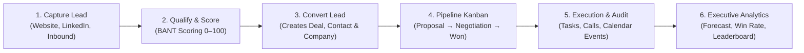
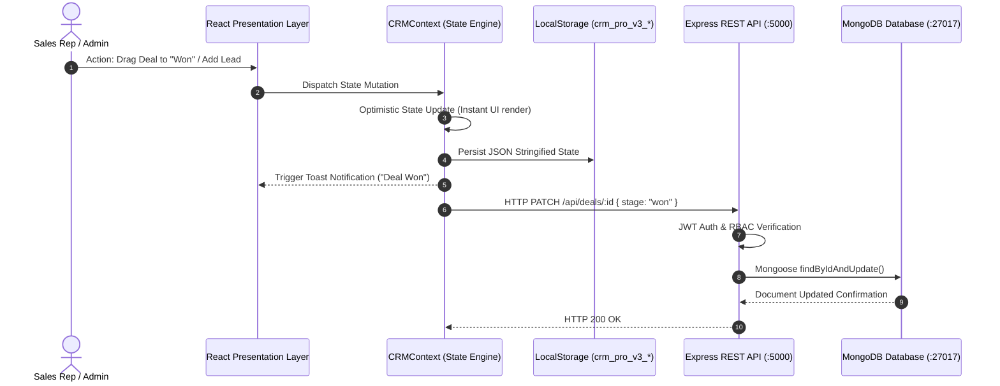

# CRM Pro — End-to-End Operational Workflow & Architecture Guide

**Document Version:** 1.0.0  
**Scope:** Sales Lifecycle Operations, System State Transition Flow, and Technical Data Pipeline  

---

## 1. The B2B Sales Revenue Lifecycle

CRM Pro is engineered around the standard enterprise B2B sales cycle. A prospective customer flows through 5 interconnected phases:



---

## 2. Detailed Operational Workflow (Step-by-Step)

### Phase 1: Lead Capture & Qualification
1. **Ingestion:** Leads arrive via Marketing channels (Website, LinkedIn, Google Ads, Referrals, Inbound Email) or are manually created via the **"+ Add Lead"** button in [`LeadsView.tsx`](src/components/leads/LeadsView.tsx).
2. **Initial State:** A lead is created with status `New`, an assigned sales owner, and an initial qualification score (0–100).
3. **Engagement:** Sales reps reach out via phone or email (logged directly to the record). The status updates:
   - `New` → `Contacted` → `Qualified`.
4. **Qualification Scoring:** Leads scoring above 70 receive a high-priority "Hot Lead" flame badge 🔥 and are flagged on the executive dashboard.

---

### Phase 2: One-Click Lead Conversion
When a lead is deemed sales-ready (BANT qualified: Budget, Authority, Need, Timeline):
1. The rep clicks **"Convert Lead"** in [`ConvertLeadModal.tsx`](src/components/leads/ConvertLeadModal.tsx).
2. The platform performs an atomic 3-in-1 record transformation:
   - **Creates a Deal:** An active opportunity placed into the `Qualified` stage with an estimated contract value (e.g. ₹15,00,000) and expected close date.
   - **Creates a Contact:** Extracts the lead's name, email, direct phone, and job title into the directory with lifecycle stage `Opportunity`.
   - **Creates a Company Account:** Establishes the corporate entity in [`CompaniesView.tsx`](src/components/companies/CompaniesView.tsx) with firmographic tracking.
3. The lead's status transitions to `Converted`.

---

### Phase 3: Sales Pipeline & Deal Velocity (Kanban Board)
The converted deal is now tracked visually in [`KanbanBoard.tsx`](src/components/deals/KanbanBoard.tsx) across 5 core stages:

```
┌──────────────┐     ┌──────────────┐     ┌──────────────┐     ┌──────────────┐     ┌──────────────┐
│ 1. New Lead  │ ──► │ 2. Qualified │ ──► │ 3. Proposal  │ ──► │4.Negotiation │ ──► │   5. Won     │
│ (20% Prob)   │     │ (40% Prob)   │     │ (60% Prob)   │     │ (80% Prob)   │     │  (100% Prob) │
└──────────────┘     └──────────────┘     └──────────────┘     └──────────────┘     └──────────────┘
```

1. **Drag-and-Drop Progression:** Sales reps drag deal cards from left to right as milestones are hit:
   - Moving to **Proposal** automatically prompts proposal document uploads.
   - Moving to **Negotiation** prompts contract revision notes.
   - Moving to **Won** locks the deal value into the company's annual revenue.
2. **Probability-Weighted ARR:** As deals move forward, the platform automatically calculates probability-weighted revenue (e.g. ₹20L deal at 80% = ₹16L weighted forecast).
3. **Deal Inspection Drawer:** Clicking any deal opens [`DealDrawer.tsx`](src/components/deals/DealDrawer.tsx), allowing users to view associated contacts, upload PDF quotes, review timeline events, and append audit notes.

---

### Phase 4: Sales Productivity & Execution
To close deals, reps utilize three integrated execution modules:
1. **Task Management ([`TasksView.tsx`](src/components/tasks/TasksView.tsx)):**
   - Reps organize tasks via **List**, **Kanban**, or **Calendar** modes.
   - Tasks are linked directly to specific deals and assigned urgency levels (`Urgent`, `High`, `Medium`, `Low`).
2. **Calendar & Meeting Scheduler ([`CalendarView.tsx`](src/components/calendar/CalendarView.tsx)):**
   - Reps book demos, discovery sessions, and review calls with built-in Google Meet links.
   - Month, Week, and Day views provide full schedule clarity.
3. **Chronological Audit Trail ([`ActivitiesView.tsx`](src/components/activities/ActivitiesView.tsx)):**
   - Automatically records every phone call, email, demo, deal stage transition, note, and task completion in an immutable audit timeline.

---

### Phase 5: Executive Analytics & Performance Governance
Sales leaders monitor pipeline health in real time via [`AnalyticsView.tsx`](src/components/analytics/AnalyticsView.tsx):
- **Period Filtering:** Instantly filter data by `Today`, `7 Days`, `30 Days`, `3 Months`, or `1 Year`.
- **Sales Revenue Chart:** Compares closed revenue against sales quota targets.
- **Leads Generated Chart:** Breaks down inbound vs outbound acquisition velocity.
- **Conversion Funnel:** Analyzes drop-off rates between `Leads` → `Qualified` → `Proposal` → `Won`.
- **Pipeline Donut:** Displays deal capital distribution by pipeline stage.
- **Sales Leaderboard:** Ranks reps (Viraj, Rahul, Priya, Alex, Maya) by quota attainment percentage and win rate.
- **Lead Sources Breakdown:** Tracks ROI across Website, LinkedIn, Referrals, Google Ads, and Email.

---

## 3. Power-User Navigation & Accessibility Workflows

### 3.1 Universal Command Palette (`⌘K` / `Ctrl+K`)
- Pressing `⌘K` or `Ctrl+K` opens the fuzzy search modal.
- Type any lead name, company, deal title, or navigation page to jump directly to it in milliseconds.

### 3.2 Keyboard Navigation Chords (Two-Key Jumps)
Press `G` followed by a second key to switch views instantly without touching the mouse:
- `G` then `D` → **Dashboard Overview**
- `G` then `L` → **Leads Directory**
- `G` then `O` → **Deals Pipeline (Opportunities)**
- `G` then `C` → **Contacts Directory**
- `G` then `A` → **Activity Timeline**
- `G` then `T` → **Tasks Manager**
- `G` then `E` → **Calendar (Events)**
- `G` then `R` → **Reports & Analytics**
- `G` then `S` → **Settings & Admin**

---

## 4. Technical Data Flow & Architecture



---

## 5. Zero-State (Clean Slate) vs Demo Data Modes

CRM Pro provides dual operational modes to facilitate both real daily usage and developer portfolio reviews:

1. **Clean Slate Mode ("Reset All Data to Zero"):**
   - Accessible via the Top Header Profile Menu.
   - Clears all MongoDB collections and resets frontend state to `0`.
   - Scorecards render `0`, `₹0`, and `0.0%` with flat sparklines `[0,0,0,0,0]`.
   - Preserves admin user authentication (`viraj@crmpro.io`).
2. **Demo Mode ("Load Sample Demo Data"):**
   - Accessible via the same dropdown menu.
   - Instantly populates the CRM with authentic Indian and international enterprise entities (TechNova Solutions, Acme Technologies, BrightLabs, CloudCore Systems, PixelWorks, InnovateX), 1,248 leads, and ₹91.48L active pipeline for instant recruiter demonstration.

